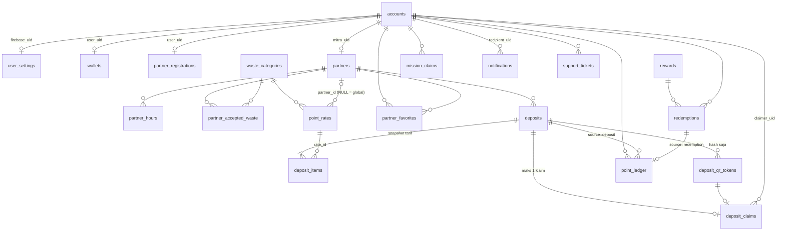

# Model data runtime EcoSnap-BE

Handoff ringkas model data **yang benar-benar ada di SQL**: `database/migrations/00001`–`00012` (goose, skema `public`). Migration adalah satu-satunya sumber kebenaran runtime. DBML 33 tabel di desain lama adalah arsip dan **bukan** sumber runtime kedua.

> Dokumen dan diagram ini ditulis tangan, **bukan generator migration**. Perbarui setiap ada migration baru (tabel, kolom, constraint, trigger, kebijakan akses). Jika berbeda dengan SQL, SQL yang benar.
> Dokumen ini tidak mengklaim status penerapan ke Supabase maupun hasil tes terbaru; lihat [runbook migration](supabase-migration-runbook.md) dan [hasil tes](test-results/) untuk itu.

Hitungan hasil parsing `CREATE TABLE` pada bagian Up: **21 tabel** (migration 00001–00012).

## Akses dan keamanan data

- Semua 21 tabel: `ENABLE ROW LEVEL SECURITY` dan `REVOKE ALL ... FROM anon, authenticated`. Tidak ada policy RLS di migration, jadi klien Supabase langsung (anon/authenticated) tidak mendapat akses.
- Hanya backend yang mengakses data, lewat koneksi `DATABASE_URL` milik owner/role server. Koneksi owner biasanya melewati RLS; perlindungan nyata ada pada kontrol akses API (token Firebase diverifikasi, UID diambil dari token, bukan dari body), bukan pada RLS.
- Fungsi trigger notifikasi (`00011`) di-`REVOKE` dari `PUBLIC, anon, authenticated`.
- Tidak ada role admin. Tiket dukungan dibaca/dijawab pemilik repo lewat `cmd/support-tickets` dengan `DATABASE_URL` owner ([support](api/support.md)).
- Tidak ada kredensial di dokumen ini.

## UID vs ID

| Jenis | Format | Dipakai untuk |
|---|---|---|
| Firebase UID | `VARCHAR(128)` | `accounts.firebase_uid` (PK); kolom `user_uid`, `mitra_uid`, `created_by_uid`, `issued_by_uid`, `claimer_uid`, `recipient_uid` semuanya FK ke `accounts` |
| ID internal | `UUID` | PK entitas (`partners.id`, `deposits.id`, `redemptions.id`, dst.) |
| PK khusus | UID / ID setoran / komposit | `wallets.user_uid`, `user_settings.firebase_uid`, `partner_registrations.user_uid` (PK = UID); `deposit_claims.deposit_id`; `mission_claims (user_uid, mission_id, period_start)` |

Satu akun = satu `firebase_uid`; `role` ∈ `user|mitra`, `status` ∈ `active|suspended|deleted`. Satu mitra = satu `partners` (`mitra_uid` UNIQUE).

## Relasi utama

Tabel mandiri tanpa FK: `articles`. Alur setoran: `deposits` (`created`) → QR diterbitkan (`qr_issued`, terbit ulang tetap `qr_issued`) → klaim (`claimed`) → `deposit_claims` + `point_ledger` (+ kenaikan `wallets`, dikelola kode aplikasi) → trigger notifikasi.

## Entitas per migration

| Migration | Tabel | Catatan |
|---|---|---|
| 00001 | `accounts`, `user_settings`, `wallets` | wallet: `balance`, `total_earned`, `total_spent` INTEGER, masing-masing `CHECK >= 0` |
| 00002 | `partner_registrations` | pendaftaran bukan lokasi terverifikasi / izin menerbitkan QR |
| 00003 | `waste_categories`, `partners`, `partner_hours`, `partner_accepted_waste` | `partners.status` enum `pending|verified|rejected|suspended`; koordinat dibatasi CHECK; `UNIQUE(partner_id, day_of_week)` |
| 00004 | `partner_favorites` | `UNIQUE(user_uid, partner_id)` |
| 00005 | `point_rates` | versi tarif per `active_from`; unique parsial global vs per mitra; `is_demo` |
| 00006 | `deposits`, `deposit_items` | snapshot tarif; lihat bawah |
| 00007 | `deposit_qr_tokens`, `deposit_claims`, `point_ledger` | hash token; satu klaim per setoran; ledger |
| 00008 | `rewards`, `redemptions` (+ kolom `point_ledger.redemption_id`) | voucher simulasi |
| 00009 | `articles` | konten teks terstruktur, `sections` JSONB array |
| 00010 | `mission_claims` (+ index `deposit_claims_claimer_idx`) | XP misi mingguan terpisah dari poin |
| 00011 | `notifications` | inbox in-app lewat trigger |
| 00012 | `support_tickets` | laporan masalah/masukan |

## Data asli immutable: yang benar-benar dijaga DB vs aplikasi

Jangan menyebut tabel immutable bila tidak ada trigger.

| Tabel | Dijaga trigger DB? | Rincian |
|---|---|---|
| `deposit_claims` | **Ya** (`00010`, `BEFORE UPDATE OR DELETE` → `restrict_violation`) | tidak bisa diubah/dihapus (tetap bisa di-TRUNCATE/DROP oleh owner) |
| `mission_claims` | **Ya** (`00010`) | sama |
| `support_tickets` | **Sebagian** (`00012`) | DELETE ditolak; UPDATE hanya boleh mengubah `status`, `staff_response`, `responded_at`, `updated_at`. `id, user_uid, idempotency_key, request_hash, kind, subject, message, created_at` tidak bisa berubah |
| `point_ledger` | **Tidak** | komentar migration: "append-only", tetapi tidak ada trigger. Hanya konvensi aplikasi: koreksi = entri baru |
| `deposits`, `deposit_items`, `redemptions`, `deposit_qr_tokens` | **Tidak** | snapshot/riwayat dijaga kode aplikasi; `deposit_qr_tokens` dan `redemptions` memang berubah (`revoked_at/used_at`, `status/used_at`); `deposits.status` berubah |
| `notifications` | **Tidak** | komentar: `seen_at` diisi sekali oleh pemilik, itu aturan aplikasi (hanya CHECK `seen_at >= created_at`) |

## Snapshot, idempotency, unique, check

- **Snapshot tarif**: `deposit_items` menyalin `category_name`, `rate_id`, `rate_hundredths`, `is_demo`; `exact_points_e5 = weight_grams * rate_hundredths` (CHECK). `deposits` menyimpan `total_weight_grams` (1..1.000.000), `total_points`, `uses_demo_rates`, `rates_as_of`. Perubahan tarif kemudian tidak mengubah riwayat. `redemptions` menyalin `reward_name`, `cost_points`.
- **Idempotency**: `deposits UNIQUE(partner_id, idempotency_key)` + `request_hash CHAR(64)`; `redemptions UNIQUE(user_uid, idempotency_key)`; `support_tickets UNIQUE(user_uid, idempotency_key)` + `request_hash` hex-64; `point_ledger.idempotency_key UNIQUE` (global); `notifications UNIQUE(recipient_uid, event_type, source_id)`. Format kunci klien `^[A-Za-z0-9_-]{8,128}$`.
- **Satu klaim**: `deposit_claims.deposit_id` PK dan `qr_token_id` UNIQUE; `mission_claims` PK `(user_uid, mission_id, period_start)`; `point_ledger.redemption_id` UNIQUE.
- **Satu token hidup**: unique parsial `deposit_qr_tokens(deposit_id) WHERE revoked_at IS NULL AND used_at IS NULL`; CHECK `expires_at > issued_at`, `revoked_at IS NULL OR used_at IS NULL`.
- **Saldo/poin (integritas)**: `wallets.*` ≥ 0; `point_ledger.amount <> 0`; `source='deposit'` mewajibkan `deposit_id`; `source='redemption'` mewajibkan `redemption_id` dan `amount < 0`; `deposit_claims.points >= 0`; `rewards.stock >= 0`, `cost_points` 1..100.000.000. `ledger_source` enum: `deposit|redemption`.
- **Poin app-only**: tidak ada trigger yang menyinkronkan `wallets` dengan `point_ledger` dan tidak ada constraint DB yang menjamin `wallets.balance = SUM(point_ledger.amount)`. Konsistensi dijaga transaksi dan locking di kode aplikasi.
- **XP** (`mission_claims.xp`) terpisah dari wallet dan ledger. `mission_claims`: `progress >= target`, `claimed_at` dalam `[period_start, period_end)`; periode Senin 00:00 Asia/Jakarta (akhir eksklusif). Lencana diturunkan dari `deposit_claims` (tidak disimpan).
- **Notifikasi**: dibuat trigger `AFTER INSERT` pada `deposit_claims`, `redemptions`, `mission_claims` dalam transaksi yang sama; hormati `user_settings.notification_enabled` (tidak ada baris settings = tidak ada notifikasi); tidak ada push/email dan tidak ada back-fill.
- `deposit_status`: `created|qr_issued|claimed`. `voucher_status`: `issued|used` (`expired` tidak disimpan).

## Data sensitif / privat

- **QR**: hanya SHA-256 token bearer (`token_hash`) yang disimpan; token mentah tidak ada di DB.
- **Voucher**: `redemptions.voucher_code` disimpan sebagai teks (UNIQUE, bukan hash); perlakukan sebagai rahasia pemilik, jangan dilog.
- PII akun: `accounts.full_name, email, phone, photo_path`; `partners.phone/address/latitude/longitude`; `partner_registrations`; isi `support_tickets` (teks bebas) dan `staff_response`.
- `request_hash` dan `idempotency_key` internal untuk deteksi replay.

## Retensi (fakta aktual)

- **Tidak ada job kedaluwarsa/penghapusan** di migration (komentar `00011`: "no expiry job"). Tidak ada TTL, partisi, maupun purge. Tidak ada penghapusan otomatis dan jangan menyiratkan kepatuhan produksi.
- Kedaluwarsa hanya **diturunkan server**: QR (`deposit_qr_tokens.expires_at`) dan voucher (`redemptions.expires_at`; `issued` melewati `expires_at` dianggap expired, status tidak diubah). Baris kedaluwarsa tetap tersimpan.
- `support_tickets` tidak pernah dihapus (trigger). `deposit_claims`/`mission_claims` tidak dapat dihapus lewat UPDATE/DELETE.
- `accounts.status='deleted'` hanyalah nilai enum; tidak ada alur penghapusan data yang diimplementasikan di skema.

## Belum diimplementasikan / keputusan tertunda

- Tabel AI (pemindaian/klasifikasi), game lanjutan, media/unggah foto (hanya `accounts.photo_path` teks), dan admin (tidak ada role/tabel admin; hanya CLI owner untuk tiket) **belum ada** di migration. Sisa DBML 33 tabel adalah arsip.
- Keputusan hukum/retensi **belum diputuskan**: masa simpan data pribadi, penghapusan akun/hak subjek data, anonimisasi, masa simpan tiket/ledger, kebijakan banding (Q-17; koreksi ledger di masa depan hanya lewat entri baru), serta kepatuhan produksi.
- Tidak ada pernyataan di sini soal kepatuhan hukum.

## Tautan

- Migration: [`database/migrations/`](../database/migrations/) · Runbook: [supabase-migration-runbook.md](supabase-migration-runbook.md) · Index API: [api/README.md](api/README.md)
- Per fitur: [accounts](api/accounts.md) · [partners](api/partners.md) · [partner-favorites](api/partner-favorites.md) · [point-estimates](api/point-estimates.md) · [deposits](api/deposits.md) · [wallet-history](api/wallet-history.md) · [rewards](api/rewards.md) · [articles](api/articles.md) · [gamification](api/gamification.md) · [activity-reports](api/activity-reports.md) · [notifications](api/notifications.md) · [support](api/support.md) · [android-integration](api/android-integration.md)
