# EcoSnap - Inventaris Figma dan gambar referensi

Status: snapshot bukti untuk penyusunan PRD. Desain belum diubah dan prioritas fitur belum ditetapkan.

## Sumber dan cakupan

- [File Figma EcoSnap](https://www.figma.com/design/GcZxuR5nuaOH8GB1Lo37lW/EcoSnap).
- Ketiga page berhasil dibaca melalui metadata konektor Figma: Design System (`3:2`), Hi Fi (`0:1`), dan WireFrame (`117:407`).
- Hi Fi memuat **42 frame layar dengan lebar 428** dan **5 frame tambahan** di dalam empat section. WireFrame memuat **14 frame**. Design System memuat **15 shape swatch warna**; jumlah ini belum membuktikan adanya sistem komponen atau token lengkap.
- **10 gambar gabungan dari pengguna** disalin utuh. Gambar tersebut menampilkan 42 layar utama dan satu potongan panduan pemanfaatan kembali. Pencocokan memakai isi visual dan nama frame; ini bukan pembuktian bahwa screenshot identik piksel dengan versi Figma saat dibaca.
- Satu export Figma langsung berhasil disimpan: pop-up serbaguna (`200:184`). Export massal berikutnya ditolak karena batas panggilan Figma MCP plan Starter. **Seluruh frame dan aset sumber Figma belum berhasil diunduh.**
- Gambar dari PDF tetap tersedia dalam [ekstraksi laporan](../utp-resubmission.extracted.md), sebagai snapshot PDF terpisah yang dapat berbeda dari desain terbaru.
- [Catatan kelengkapan](ui-completeness-notes.md), [inventaris node](node-inventory.json), [manifest gambar pengguna](user-image-manifest.json), dan [manifest unduhan langsung](download-manifest.json).

## Layar Hi Fi

### Splash + On Boarding

| Node | Nama frame | Ukuran canvas | Referensi tersimpan |
|---|---|---|---|
| [4:18](https://www.figma.com/design/GcZxuR5nuaOH8GB1Lo37lW/EcoSnap?node-id=4-18) | Splash | 428 x 926 | [Gambar 1](user-provided/01-onboarding.png) |
| [1:2](https://www.figma.com/design/GcZxuR5nuaOH8GB1Lo37lW/EcoSnap?node-id=1-2) | On-Boarding - 1 | 428 x 926 | [Gambar 1](user-provided/01-onboarding.png) |
| [5:69](https://www.figma.com/design/GcZxuR5nuaOH8GB1Lo37lW/EcoSnap?node-id=5-69) | On-Boarding - 2 | 428 x 926 | [Gambar 1](user-provided/01-onboarding.png) |
| [5:84](https://www.figma.com/design/GcZxuR5nuaOH8GB1Lo37lW/EcoSnap?node-id=5-84) | On-Boarding - 3 | 428 x 926 | [Gambar 1](user-provided/01-onboarding.png) |

### Auth

| Node | Nama frame | Ukuran canvas | Referensi tersimpan |
|---|---|---|---|
| [7:132](https://www.figma.com/design/GcZxuR5nuaOH8GB1Lo37lW/EcoSnap?node-id=7-132) | Login | 428 x 926 | [Gambar 2](user-provided/02-authentication.png) |
| [12:403](https://www.figma.com/design/GcZxuR5nuaOH8GB1Lo37lW/EcoSnap?node-id=12-403) | Register - User | 428 x 926 | [Gambar 2](user-provided/02-authentication.png) |
| [13:486](https://www.figma.com/design/GcZxuR5nuaOH8GB1Lo37lW/EcoSnap?node-id=13-486) | Register - Mitra | 428 x 926 | [Gambar 2](user-provided/02-authentication.png) |
| [313:2](https://www.figma.com/design/GcZxuR5nuaOH8GB1Lo37lW/EcoSnap?node-id=313-2) | Forgot Password | 428 x 926 | [Gambar 2](user-provided/02-authentication.png) |
| [315:40](https://www.figma.com/design/GcZxuR5nuaOH8GB1Lo37lW/EcoSnap?node-id=315-40) | Check Email | 428 x 926 | [Gambar 2](user-provided/02-authentication.png) |
| [316:130](https://www.figma.com/design/GcZxuR5nuaOH8GB1Lo37lW/EcoSnap?node-id=316-130) | New Password | 428 x 926 | [Gambar 2](user-provided/02-authentication.png) |

### Mitra

| Node | Nama frame | Ukuran canvas | Referensi tersimpan |
|---|---|---|---|
| [121:1194](https://www.figma.com/design/GcZxuR5nuaOH8GB1Lo37lW/EcoSnap?node-id=121-1194) | Beranda | 428 x 963 | [Gambar 10](user-provided/10-partner-deposit-qr.png) |
| [39:573](https://www.figma.com/design/GcZxuR5nuaOH8GB1Lo37lW/EcoSnap?node-id=39-573) | Kalkulator Sampah | 428 x 892 | [Gambar 10](user-provided/10-partner-deposit-qr.png) |
| [37:258](https://www.figma.com/design/GcZxuR5nuaOH8GB1Lo37lW/EcoSnap?node-id=37-258) | Generate QR | 428 x 1142 | [Gambar 10](user-provided/10-partner-deposit-qr.png) |

### User

| Node | Nama frame | Ukuran canvas | Referensi tersimpan |
|---|---|---|---|
| [24:3](https://www.figma.com/design/GcZxuR5nuaOH8GB1Lo37lW/EcoSnap?node-id=24-3) | Beranda | 428 x 1177 | [Gambar 3](user-provided/03-home-map-camera.png) |
| [24:86](https://www.figma.com/design/GcZxuR5nuaOH8GB1Lo37lW/EcoSnap?node-id=24-86) | Peta | 428 x 926 | [Gambar 3](user-provided/03-home-map-camera.png) |
| [179:637](https://www.figma.com/design/GcZxuR5nuaOH8GB1Lo37lW/EcoSnap?node-id=179-637) | Mitra - Detail | 428 x 1328 | [Gambar 3](user-provided/03-home-map-camera.png) |
| [24:191](https://www.figma.com/design/GcZxuR5nuaOH8GB1Lo37lW/EcoSnap?node-id=24-191) | Foto Sampah | 428 x 872 | [Gambar 3](user-provided/03-home-map-camera.png) |
| [227:21](https://www.figma.com/design/GcZxuR5nuaOH8GB1Lo37lW/EcoSnap?node-id=227-21) | Hasil Foto | 428 x 1853 | [Gambar 4](user-provided/04-scan-results-and-qr.png) |
| [229:201](https://www.figma.com/design/GcZxuR5nuaOH8GB1Lo37lW/EcoSnap?node-id=229-201) | Frame 8 | 382 x 407 | [Gambar 4](user-provided/04-scan-results-and-qr.png) |
| [229:234](https://www.figma.com/design/GcZxuR5nuaOH8GB1Lo37lW/EcoSnap?node-id=229-234) | Frame 9 | 382 x 407 | Belum ada export tersendiri |
| [32:2](https://www.figma.com/design/GcZxuR5nuaOH8GB1Lo37lW/EcoSnap?node-id=32-2) | Scan QR | 428 x 872 | [Gambar 4](user-provided/04-scan-results-and-qr.png) |
| [229:266](https://www.figma.com/design/GcZxuR5nuaOH8GB1Lo37lW/EcoSnap?node-id=229-266) | Scan Berhasil | 428 x 944 | [Gambar 4](user-provided/04-scan-results-and-qr.png) |
| [32:78](https://www.figma.com/design/GcZxuR5nuaOH8GB1Lo37lW/EcoSnap?node-id=32-78) | Poin | 428 x 1305 | [Gambar 5](user-provided/05-rewards-and-games.png) |
| [179:395](https://www.figma.com/design/GcZxuR5nuaOH8GB1Lo37lW/EcoSnap?node-id=179-395) | Voucher - Detail | 428 x 811 | [Gambar 5](user-provided/05-rewards-and-games.png) |
| [75:2](https://www.figma.com/design/GcZxuR5nuaOH8GB1Lo37lW/EcoSnap?node-id=75-2) | Games | 428 x 996 | [Gambar 5](user-provided/05-rewards-and-games.png) |
| [179:866](https://www.figma.com/design/GcZxuR5nuaOH8GB1Lo37lW/EcoSnap?node-id=179-866) | Games - All | 428 x 904 | [Gambar 5](user-provided/05-rewards-and-games.png) |
| [181:195](https://www.figma.com/design/GcZxuR5nuaOH8GB1Lo37lW/EcoSnap?node-id=181-195) | Games - Detail | 428 x 1059 | [Gambar 6](user-provided/06-sorting-game.png) |
| [181:455](https://www.figma.com/design/GcZxuR5nuaOH8GB1Lo37lW/EcoSnap?node-id=181-455) | Games - Pilah 1 | 428 x 1015 | [Gambar 6](user-provided/06-sorting-game.png) |
| [182:743](https://www.figma.com/design/GcZxuR5nuaOH8GB1Lo37lW/EcoSnap?node-id=182-743) | Games - Pilah 1 Benar | 428 x 1132 | [Gambar 6](user-provided/06-sorting-game.png) |
| [183:870](https://www.figma.com/design/GcZxuR5nuaOH8GB1Lo37lW/EcoSnap?node-id=183-870) | Games - Pilah 1 Salah | 428 x 1135 | [Gambar 6](user-provided/06-sorting-game.png) |
| [184:982](https://www.figma.com/design/GcZxuR5nuaOH8GB1Lo37lW/EcoSnap?node-id=184-982) | Games - Pilah 1 Selesai | 428 x 791 | [Gambar 6](user-provided/06-sorting-game.png) |
| [84:72](https://www.figma.com/design/GcZxuR5nuaOH8GB1Lo37lW/EcoSnap?node-id=84-72) | Kalkulator | 428 x 1023 | [Gambar 7](user-provided/07-calculator-articles-leaderboards.png) |
| [93:166](https://www.figma.com/design/GcZxuR5nuaOH8GB1Lo37lW/EcoSnap?node-id=93-166) | Artikel | 428 x 1510 | [Gambar 7](user-provided/07-calculator-articles-leaderboards.png) |
| [103:528](https://www.figma.com/design/GcZxuR5nuaOH8GB1Lo37lW/EcoSnap?node-id=103-528) | Artikel - 1 | 428 x 1008 | [Gambar 7](user-provided/07-calculator-articles-leaderboards.png) |
| [104:732](https://www.figma.com/design/GcZxuR5nuaOH8GB1Lo37lW/EcoSnap?node-id=104-732) | Leaderboard - Setor | 428 x 1560 | [Gambar 7](user-provided/07-calculator-articles-leaderboards.png) |
| [115:1188](https://www.figma.com/design/GcZxuR5nuaOH8GB1Lo37lW/EcoSnap?node-id=115-1188) | Leaderboard - Games | 428 x 1544 | [Gambar 7](user-provided/07-calculator-articles-leaderboards.png) |
| [115:1568](https://www.figma.com/design/GcZxuR5nuaOH8GB1Lo37lW/EcoSnap?node-id=115-1568) | Riwayat | 428 x 1194 | [Gambar 8](user-provided/08-history-profile-settings.png) |
| [117:196](https://www.figma.com/design/GcZxuR5nuaOH8GB1Lo37lW/EcoSnap?node-id=117-196) | Riwayat - 1 | 428 x 667 | [Gambar 8](user-provided/08-history-profile-settings.png) |
| [123:1440](https://www.figma.com/design/GcZxuR5nuaOH8GB1Lo37lW/EcoSnap?node-id=123-1440) | Profile | 428 x 1479 | [Gambar 8](user-provided/08-history-profile-settings.png) |
| [141:30](https://www.figma.com/design/GcZxuR5nuaOH8GB1Lo37lW/EcoSnap?node-id=141-30) | Pengaturan Akun | 428 x 512 | [Gambar 8](user-provided/08-history-profile-settings.png) |
| [141:266](https://www.figma.com/design/GcZxuR5nuaOH8GB1Lo37lW/EcoSnap?node-id=141-266) | Pusat Bantuan | 428 x 573 | [Gambar 8](user-provided/08-history-profile-settings.png) |
| [152:375](https://www.figma.com/design/GcZxuR5nuaOH8GB1Lo37lW/EcoSnap?node-id=152-375) | Kartu mitra | 380 x 113 | Belum ada export tersendiri |
| [152:383](https://www.figma.com/design/GcZxuR5nuaOH8GB1Lo37lW/EcoSnap?node-id=152-383) | Kartu mitra | 380 x 128 | Belum ada export tersendiri |
| [166:160](https://www.figma.com/design/GcZxuR5nuaOH8GB1Lo37lW/EcoSnap?node-id=166-160) | Laporan Aktivitas — Pengguna | 428 x 1216 | [Gambar 9](user-provided/09-reports-and-support.png) |
| [198:2](https://www.figma.com/design/GcZxuR5nuaOH8GB1Lo37lW/EcoSnap?node-id=198-2) | Laporkan Masalah | 428 x 1135 | [Gambar 9](user-provided/09-reports-and-support.png) |
| [198:92](https://www.figma.com/design/GcZxuR5nuaOH8GB1Lo37lW/EcoSnap?node-id=198-92) | Kirim Masukan | 428 x 1135 | [Gambar 9](user-provided/09-reports-and-support.png) |
| [200:184](https://www.figma.com/design/GcZxuR5nuaOH8GB1Lo37lW/EcoSnap?node-id=200-184) | EcoSnap / Pop-up Serbaguna | 963 x 522 | [Export langsung](hi-fi/popup-serbaguna-200-184.png) |

## WireFrame

Metadata 14 frame tersedia. Render langsung frame WireFrame belum diunduh karena batas konektor.

| Node | Nama frame | Ukuran canvas |
|---|---|---|
| [117:408](https://www.figma.com/design/GcZxuR5nuaOH8GB1Lo37lW/EcoSnap?node-id=117-408) | Wireframe — Generate QR | 428 x 1142 |
| [117:464](https://www.figma.com/design/GcZxuR5nuaOH8GB1Lo37lW/EcoSnap?node-id=117-464) | Wireframe — Kalkulator Sampah | 428 x 927 |
| [117:541](https://www.figma.com/design/GcZxuR5nuaOH8GB1Lo37lW/EcoSnap?node-id=117-541) | Wireframe — Poin | 428 x 1142 |
| [117:687](https://www.figma.com/design/GcZxuR5nuaOH8GB1Lo37lW/EcoSnap?node-id=117-687) | Wireframe — Scan QR | 428 x 872 |
| [117:742](https://www.figma.com/design/GcZxuR5nuaOH8GB1Lo37lW/EcoSnap?node-id=117-742) | Wireframe — Foto Sampah | 428 x 872 |
| [117:797](https://www.figma.com/design/GcZxuR5nuaOH8GB1Lo37lW/EcoSnap?node-id=117-797) | Wireframe — Peta | 428 x 926 |
| [117:886](https://www.figma.com/design/GcZxuR5nuaOH8GB1Lo37lW/EcoSnap?node-id=117-886) | Wireframe — Beranda | 428 x 1191 |
| [117:990](https://www.figma.com/design/GcZxuR5nuaOH8GB1Lo37lW/EcoSnap?node-id=117-990) | Wireframe — Register - Mitra | 428 x 926 |
| [117:1056](https://www.figma.com/design/GcZxuR5nuaOH8GB1Lo37lW/EcoSnap?node-id=117-1056) | Wireframe — Register - User | 428 x 926 |
| [117:1113](https://www.figma.com/design/GcZxuR5nuaOH8GB1Lo37lW/EcoSnap?node-id=117-1113) | Wireframe — Login | 428 x 926 |
| [117:1147](https://www.figma.com/design/GcZxuR5nuaOH8GB1Lo37lW/EcoSnap?node-id=117-1147) | Wireframe — On-Boarding - 3 | 428 x 926 |
| [117:1160](https://www.figma.com/design/GcZxuR5nuaOH8GB1Lo37lW/EcoSnap?node-id=117-1160) | Wireframe — On-Boarding - 2 | 428 x 926 |
| [117:1172](https://www.figma.com/design/GcZxuR5nuaOH8GB1Lo37lW/EcoSnap?node-id=117-1172) | Wireframe — On-Boarding - 1 | 428 x 926 |
| [117:1184](https://www.figma.com/design/GcZxuR5nuaOH8GB1Lo37lW/EcoSnap?node-id=117-1184) | Wireframe — Splash | 428 x 926 |

## Design System

Page ini berisi 15 shape swatch warna pada snapshot metadata. Isi warna, variable, style, dan component belum diaudit melalui Plugin API. Render swatch belum diunduh.

## Gambar kiriman pengguna

### Gambar 1

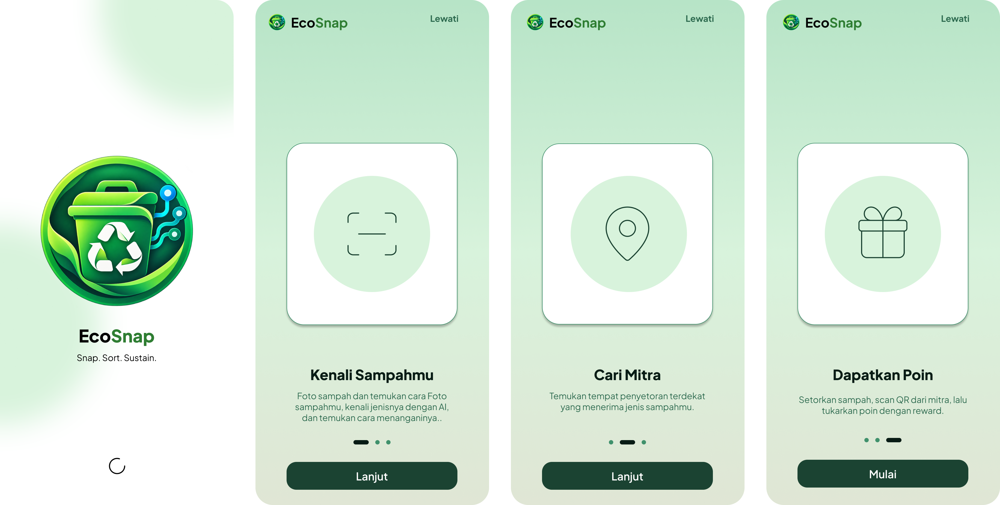

### Gambar 2

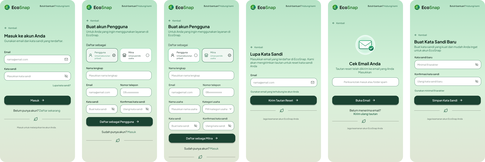

### Gambar 3

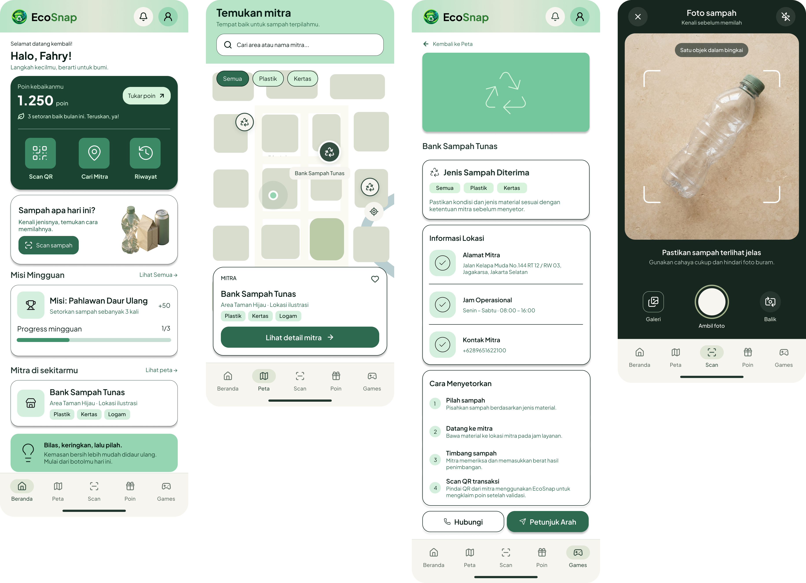

### Gambar 4

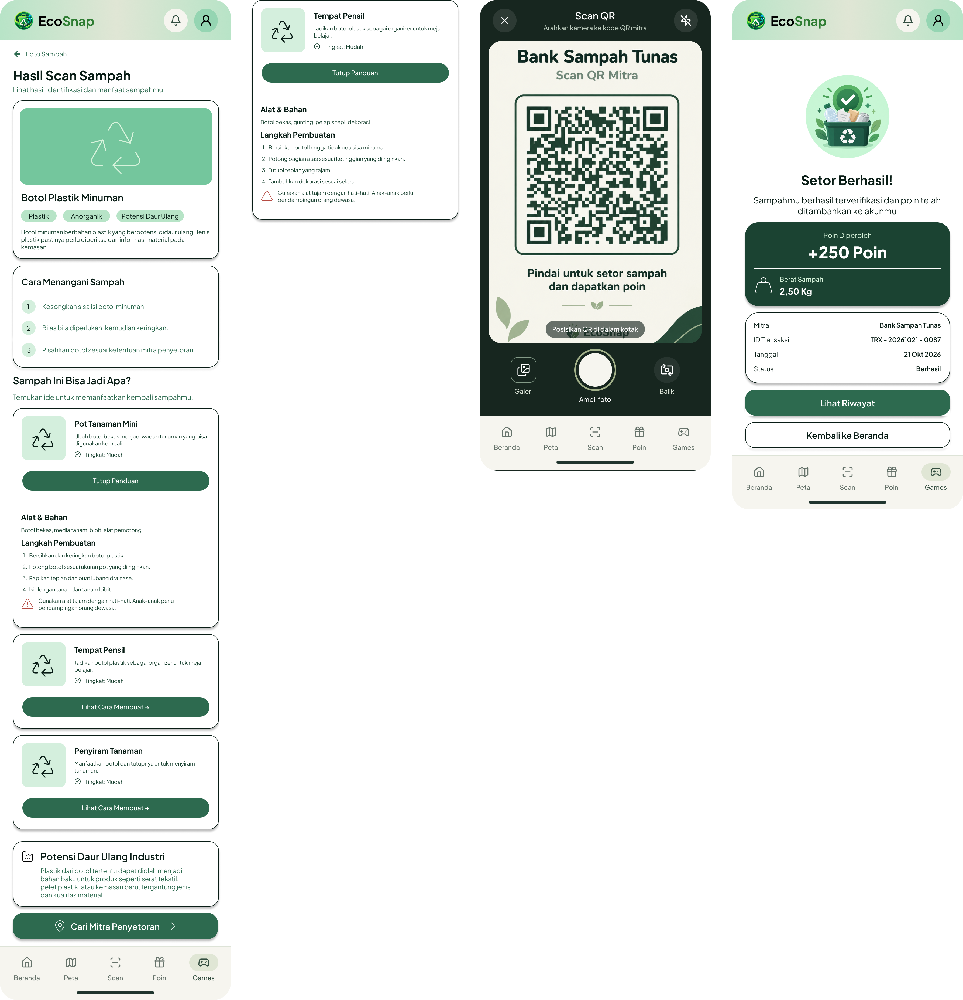

### Gambar 5

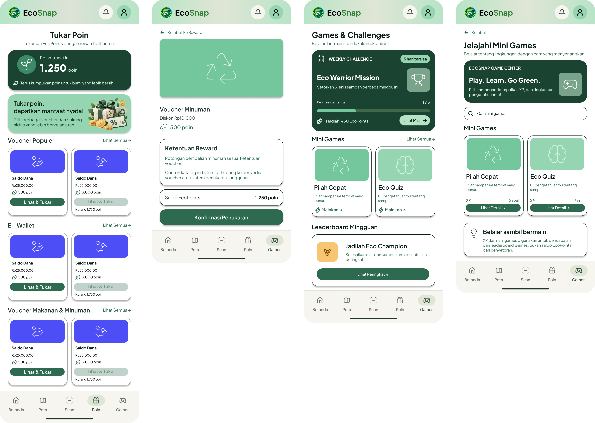

### Gambar 6

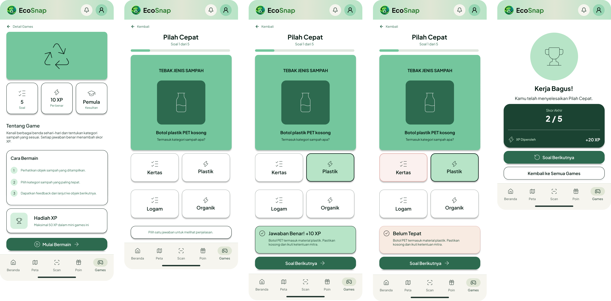

### Gambar 7

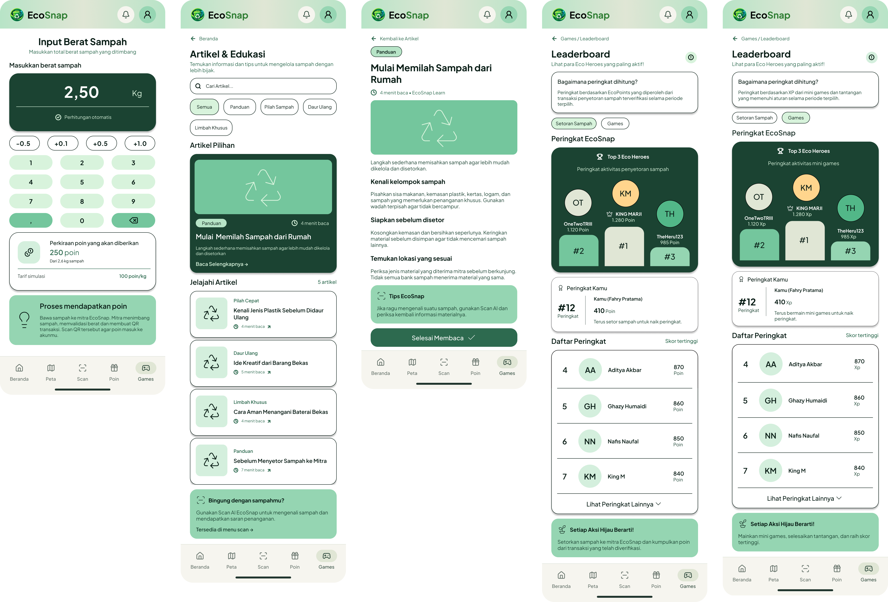

### Gambar 8

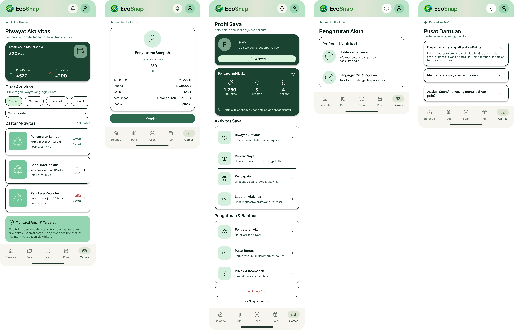

### Gambar 9

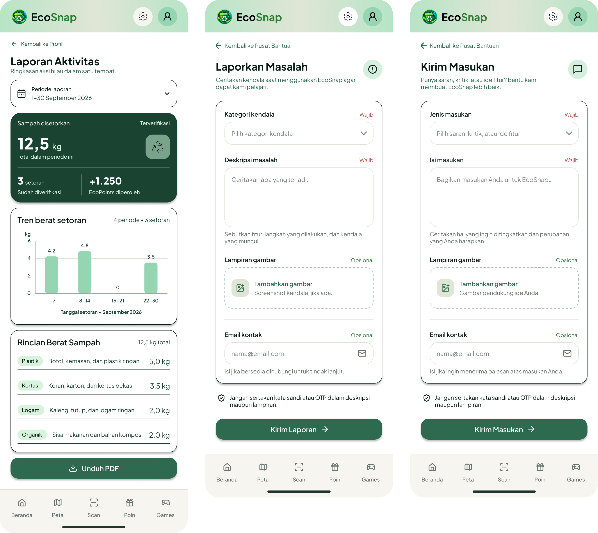

### Gambar 10

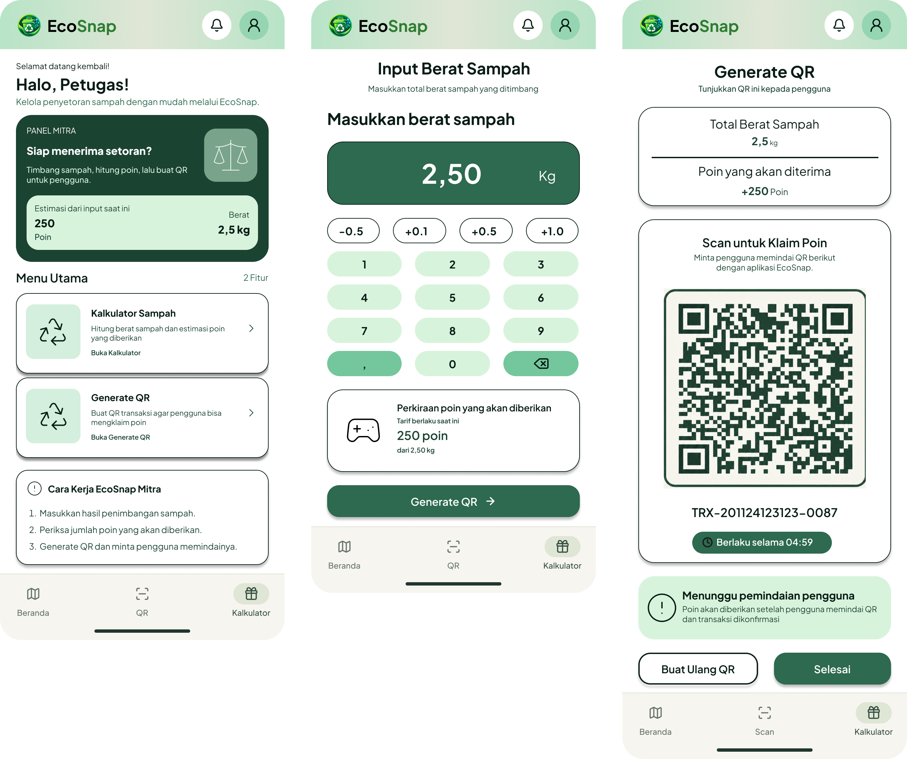

## Export langsung yang berhasil

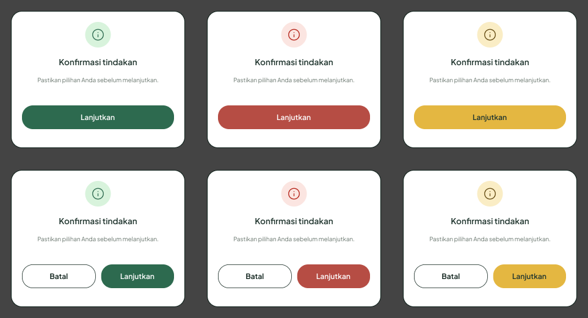
